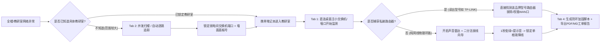

# LoopFinder 校园网环路定位仪 · 完整使用手册（v2.1）

> 适用对象：学校信息中心 / 网络运维工程师、教研室及教学楼一线排障人员  
> 支持平台：macOS（零依赖开箱即用）、Windows 10/11  
> 适用设备：华为（VRP）、新华三 H3C（Comware）、锐捷（RGOS）、思科（IOS/Catalyst）、TP-LINK 网管交换机、中兴、Aruba 及各类无网管傻瓜交换机 / 家用无线路由器

---

## 目录

1. [工具定位与排障原理](#1-工具定位与排障原理)
2. [安装、权限配置与启动指南](#2-安装权限配置与启动指南)
3. [模块一：教研室现场快速定位](#3-模块一教研室现场快速定位)
4. [模块二：弱电间汇聚与接入交换机跨品牌排查（SNMP）](#4-模块二弱电间汇聚与接入交换机跨品牌排查snmp)
5. [模块三：Console 串口直连、Syslog 告警雷达、三层路由环路与 SSH/日志解析](#5-模块三console-串口直连syslog-告警雷达三层路由环路与-ssh日志解析)
6. [模块四：教研室面板台账、防环加固脚本与工单报告](#6-模块四教研室面板台账防环加固脚本与工单报告)
7. [大教研室四大典型故障实战 SOP](#7-大教研室四大典型故障实战-sop)
8. [打包为独立桌面软件（.app / .exe）](#8-打包为独立桌面软件app--exe)
9. [常见问题 FAQ 与运维安全须知](#9-常见问题-faq-与运维安全须知)

---

## 1. 工具定位与排障原理

在学校大型教研室（20～60 个工位）中，“路由器环路/网络瘫痪”通常由以下三类故障引发，**LoopFinder 将这三类故障整合在一个离线桌面工具中闭环定位**：

| 故障类型 | 教研室常见起因 | 典型现象 | LoopFinder 定位手段 |
|---|---|---|---|
| **二层物理环路 / 广播风暴** | 老师把家用路由器两个 LAN 口都插进墙口/小交换机；或一根网线两头插回同一台桌面傻瓜交换机 | 全教研室/全楼网速暴跌、丢包 50%+、交换机灯狂闪、CPU 飙至 90%+ | 主动 `0x88B5` 环路探针 + 250ms 重复广播帧指纹 + 声音雷达二分法拔线 + SNMP 广播 PPS/MAC 漂移双采样 |
| **私接小路由器反接（Rogue DHCP）** | 墙面网线误插家用路由器 **LAN 口** 而非 WAN 口 | 部分电脑获取到 `192.168.1.x` / `192.168.0.x` 地址无法上网、或网关 ARP 冲突 | 主动 `DHCPDISCOVER` + 被动 ARP 私网暴露 + 自动读取路由器 80/8080 管理页型号 + OUI 厂商识别 |
| **三层路由环路** | 弱电间汇聚/核心三层交换机静态路由指向互指 | 特定跨网段目标彻底不通，`ping` 提示 TTL 超时 | 跨平台 Traceroute 跳点闭环自动识别 |

### 两阶段标准排障流程



---

## 2. 安装、权限配置与启动指南

### 2.1 macOS 笔记本（推荐：零第三方依赖开箱即用）

LoopFinder 在 macOS 上内置了**纯 Python 原生 `/dev/bpf*` 二层收发引擎**与**纯 Python SNMPv1/v2c 引擎**，不安装任何第三方库也能跑完所有核心功能（包含实时抓包与主动二层探针）。

1. **双击启动（最省心）**：
   * 打开项目文件夹，双击 `启动_macOS.command`。
   * 终端弹出时：
     * 输入 `Y`（或直接回车）并输入本机开机密码 → **完整权限启动**（解锁 `/dev/bpf*` 实时二层抓包 + 主动探针 + 弱电间 SNMP）。
     * 输入 `n` → **普通权限启动**（可用弱电间 SNMP 排查、Syslog 监听、Console 日志解析、三层路由检测及仿真演练）。
2. **命令行启动**：
   ```bash
   cd /path/to/LoopFinder

   # 首次上手/培训演练（自动开启仿真环路场景）
   python3 app.py --demo

   # 现场真实抓包排障（完整二层权限）
   sudo python3 app.py
   ```
3. **免 `sudo` 长期优化技巧（可选）**：
   * 如果你的 Mac 安装了 Wireshark 并勾选了 `ChmodBPF`，或在终端配置了 `/dev/bpf*` 的组读写权限，之后无需 `sudo` 即可直接双击开启实时抓包。
4. **可选增强依赖（如需 SSH 直连交换机或原生 WKWebView 独立窗体）**：
   ```bash
   pip3 install -r requirements.txt
   ```

---

### 2.2 Windows 10/11 笔记本

1. **安装 Python 3.9+**：从 python.org 下载安装，务必勾选 **`Add Python to PATH`**。
2. **安装 Npcap 驱动**（现场实时二层抓包与主动探针必需）：
   * 前往 [https://npcap.com/](https://npcap.com/) 下载安装（如果电脑已装 Wireshark，则通常已自带 Npcap）。
   * 安装界面务必勾选：**`Install Npcap in WinPcap API-compatible Mode`**。
3. **安装 Python 依赖**：
   ```bat
   pip install -r requirements.txt
   ```
4. **启动软件**：
   * 右键点击 `启动_Windows.bat` → 选择 **「以管理员身份运行」**（推荐，确保可发送原始二层探测帧）。
   * 启动后会自动以无地址栏的独立桌面窗口打开（优先使用 `pywebview` 或 Edge/Chrome `--app` 桌面模式）。

---

### 2.3 离线能力说明（无外网环境）

当整个教研室或教学楼因环路瘫痪、无法连接互联网时：
* 工具的 HTML / CSS / JavaScript、Canvas 波形图、Web Audio 声音引擎、400+ 国产路由器/交换机 OUI 厂商库**全部内置在本地**，**0 外部 CDN 请求**。
* 工具自动对 Chrome/Edge 桌面窗体注入 `--proxy-bypass-list=127.0.0.1;localhost`，避免电脑开着代理软件导致本地控制台打不开。
* **特别建议**：给运维笔记本配一个 **USB-C / USB-A 转千兆有线网卡**，现场直接插网线诊断，不要用 Wi-Fi 测二层环路。

---

## 3. 模块一：教研室现场定位

点击顶部页签 **「1. 教研室现场定位」**，适用于携带笔记本直接进入教研室、连上墙面面板或桌面傻瓜交换机的场景（**完全不需要交换机管理账号**）。

### 3.1 顶部控制栏操作说明

1. **本机网卡**：优先选择带 `🔌有线` 标记的物理网口（即使当前因环路拿不到 IP 显示「已插线/无IP」，依然可以直接抓包与测环路！）。初次体验可选择 `✨ [仿真演练模式]`。
2. **探测策略**：
   * **主动二层探针 + 被动听诊（推荐）**：每 1.5 秒发一帧 64 字节自定义探测帧（`EtherType 0x88B5`，源 MAC 为本地管理地址 `02:4C:4F:4F:50:xx`）。即使支路里没有电脑开机（空载状态），只要有环路就能毫秒级测出。
   * **安全保护机制**：一旦被动监测发现当前广播风暴已超过 `400 pps`，工具会**自动暂停主动发包**并切换为纯被动听诊，绝不给故障网络“火上浇油”。
   * **纯被动只读听诊**：绝对零发包，适合对发包极其敏感的核心网段。
3. **告警灵敏度场景**：
   * `高灵敏（小型办公室）`：广播 `200 pps` 报环路、`60 pps` 预警，适合 10 人以下办公室。
   * `标准（大教研室推荐）`：广播 `500 pps` 报环路、`150 pps` 预警，平衡日常打印机/mDNS 广播。
   * `抗干扰（机房/大VLAN）`：广播 `1200 pps` 报环路，适合上百台终端的大广播域。
4. **快捷功能按钮**：
   * `⚡ 发探针`：手动立即发出一帧二层环路探针。
   * `📡 扫私接路由`：主动广播一帧 `DHCPDISCOVER`，迫使网内所有合法及私接路由器回复 `DHCPOFFER`。
   * `💾 PCAP (N)`：把内存环形缓存里最近抓取的（最多 3,000 帧）原始以太网数据导出为标准 `.pcap` 文件，直接用 **Wireshark** 打开复盘或发给厂商技术支持。

### 3.2 核心诊断卡片怎么看？

* **顶部超大状态横幅**：
  * `🟢 网络正常`：无环路风暴。
  * `⚠️ 疑似异常`：发现私接路由器、ARP 冲突或广播偏高。
  * `🚨 确认环路`（闪烁红框 + 声音报警）：结合主动探针回环、重复广播帧爆发、广播/ARP 风暴给出 `0~100%` 置信度与明确判定依据。
  * `✅ 环路已断开`（高亮绿框 + 清脆上升提示音）：当风暴从峰值骤降至 `<80 pps` 时在 **1 秒内** 触发，明确告诉你“刚刚拔掉的那根线就是环路源！”
* **重复帧爆发（环路铁证）**：普通业务流量（如大文件传输）不会在 250ms 内反复出现完全一模一样的广播帧；只有二层环路会让同一个 ARP/mDNS 帧反复回环反射。看到重复帧占比飙升即可 100% 实锤物理环路。
* **私接小路由器 / ARP 冲突**：
  * 提前把学校合法 DHCP 服务器 IP（如 `10.10.1.1`）填入白名单并点击 `存白名单`。
  * 任何白名单外的 DHCP 响应，或通过 ARP 被动暴露的常见家用网关（`192.168.1.1`、`192.168.31.1`、`192.168.0.1` 等）都会标红，且工具会自动尝试访问其 `80/8080` Web 页提取路由器具体型号（例如 `TP-LINK TL-WR886N`、`MiWiFi`）。
  * 如出现 **ARP IP/网关冲突**（例如私接路由器把学校网关 IP 顶掉了），页面顶部会直接弹出红色冲突告警横幅。
* **上联交换机自动识别条（LLDP / CDP / STP）**：
  * 教研室墙面面板往往没贴标签，插上网线等几秒到 30 秒，只要楼层网管交换机开启了 LLDP/CDP，这里会自动显示：**交换机名 + 物理端口号 + 管理 IP + VLAN + 台账位置**，点右侧 `🔍 直连排查此上联交换机` 可无缝跳转 Tab 2！
* **点击任意 MAC 地址**：在「私接路由器」「重复帧」「Top MAC」表格中，**点击任意蓝色 MAC 地址**，都会自动跳转到 Tab 2 并在已扫描的弱电间交换机中反查它所在的物理端口！

### 3.3 声音雷达 + 二分法拔线向导（桌底傻瓜交换机杀手锏）

当确认大教研室里某个 8 口 / 16 口桌底无网管小交换机下面有环路时：
1. 确保顶部勾选了 **`🔊 声音雷达`**（并调高笔记本音量，让你钻到桌子底下拔线时不用盯着屏幕）。
2. 把笔记本插在这个小交换机（或同支路相邻口）上，确认界面呈红色环路状态。
3. 在右侧 **「✂️ 教研室二分法拔线现场向导」** 输入当前已插网线的口数（如 `8`），点击 **「开始二分法」**。
4. 按界面提示：拔掉**红色标出的前一半网线**（如 `#1 ~ #4`）：
   * 如果 1 秒内听到清脆的**上升恢复提示音**、屏幕变绿 → 点 **`✅ 拔掉后变绿/风暴消失了`**（说明问题在 `#1~#4` 之间，只需插回 `#1、#2` 继续二分）。
   * 如果依然红灯报警 → 点 **`🚨 拔掉后仍然红灯/风暴还在`**（说明问题在 `#5~#8` 之间）。
   * 点错了随时点击 **`↩ 撤销`** 回到上一步！
5. 8 口交换机最多 **3 步**、16 口最多 **4 步** 即可精确锁定到单根故障网线。

---

## 4. 模块二：弱电间汇聚与接入交换机跨品牌排查（SNMP）

点击顶部页签 **「2. 弱电间汇聚/接入(SNMP)」**。针对学校交换机品牌杂乱（华为、H3C、锐捷、思科、TP-LINK 混用）的情况，工具基于通用 RFC 标准 MIB（`IF-MIB` / `BRIDGE-MIB` / `Q-BRIDGE-MIB` / `LLDP-MIB` / `STP-MIB`）进行排查，**无需针对每个品牌单独装网管软件**。

### 4.1 弱电间交换机资产簿与一键并发扫全楼

1. 在 **「🏢 弱电间交换机资产簿」** 录入各教学楼的汇聚与接入交换机：
   * 支持为每台设备单独指定 **楼栋、角色、SNMP 团体名（Community）和版本（v2c / v1）**。
   * 录入后永久保存在本地 `loopfinder/data/campus_switches.json`，并可导出 CSV 备份。
2. **一键并发扫全楼**：
   * 在下拉框选择目标楼栋（或「全部楼栋」），点击 **`⚡ 并发扫所选交换机`**（体验可点 `✨ 演练并发扫全楼`）。
   * 工具并发对所有交换机做双采样，约 3 秒输出 **风险排行榜**（展示 CPU 利用率、最高风险分、峰值广播 PPS、MAC 漂移数、头号可疑口及教研室位置）。
   * **点击排行中任意一行**，下方立即展开该交换机的完整端口矩阵。

### 4.2 一键自动逐跳顺藤摸瓜（核心 → 汇聚 → 接入 → 墙口）

当你只知道核心或楼栋汇聚交换机 IP，不想一级一级手工查 LLDP 时：
1. 在右上角 **「🚀 一键自动逐跳顺藤摸瓜」** 输入起点交换机 IP（如 `10.10.0.1`）。
2. 可选填入在教研室抓到的异常 **目标 MAC**（留空则自动追查全网广播风暴最严重的非上联端口）。
3. 点击 **`🚀 自动逐跳定位末端端口`**（体验可点 `✨ 演练 3 级跨品牌追踪`）。
4. 工具会自动扫描起点交换机 → 识别高危/MAC 出口 → 读取 LLDP 邻居 IP 并匹配资产簿中的团体名 → 自动跳到下一台交换机继续扫描 → 直到抵达无 LLDP 交换机邻居的最末端接入端口，画出完整路径链：
   > `第1跳 CORE-Campus-S12700 (XGE1/0/3)` ➜ `第2跳 H3C-3F-Agg-SW01 (GE1/0/14)` ➜ `第3跳 HW-3F-East-SW02 (GE0/0/14 · 📍第一教学楼·302大教研室·东墙4号信息点)`

### 4.3 交换机面板矩阵与 MAC 反查

* **颜色含义**：
  * 🔴 **红框**：高危环路口（广播风暴或实时 MAC 漂移）。
  * 🟠 **橙框**：预警口（广播偏高、丢包激增、或单个接入端学习了 `≥8` 个 MAC——提示下面串接了教研室桌底小交换机！）。
  * 🟢 **绿框**：正常 Up 端口。
  * ⬜ **灰框**：未连接 Down 端口。
* **点击任意端口方块**：展开该端口的广播/组播 PPS、Mbps 吞吐、错包/丢包增量、STP 状态、台账位置，以及 LLDP 下级交换机的一键下钻按钮。
* **按 MAC 反查物理口**：在交换机摘要条右侧粘贴任意格式的 MAC（支持 `AA:BB:CC:DD:EE:FF`、`aa-bb-cc-dd-ee-ff`、`aabb-ccdd-eeff`、`aabb.ccdd.eeff`），立即标出它所在的端口与教研室面板位置。

---

## 5. 模块三：Console 串口直连、Syslog 告警雷达、三层路由环路与 SSH/日志解析

点击顶部页签 **「3. Console直连 & Syslog/SSH」**。

### 5.1 Console 串口直连自动定位广播源头口（机房带外首选！）

当你能进入机房或弱电间、且广播风暴已经把交换机 CPU 打满导致 SNMP/SSH 连不上时，**直接插 USB 转 RJ45 Console 线是最稳妥的带外排障手段**。LoopFinder 内置了跨平台串口自动定位引擎（macOS 基于原生 `termios` **零依赖直连**，Windows 安装 `pyserial` 即可）：

1. 把 USB 转 Console 线插到电脑和汇聚/接入交换机的 `CONSOLE` 口。
2. 在 **「🔌 Console 串口直连自动定位广播源头口」** 卡片中：
   * 点击刷新 `↻` 选择串口（macOS 如 `/dev/cu.usbserial-xxx`，Windows 如 `COM3`；提前体验可选 `✨ 模拟 Console 直连汇聚`）。
   * 波特率保持默认 `9600`（99% 交换机默认），品牌选 **`自动识别 (推荐)`**（支持华为 / H3C / 锐捷 / 思科 / TP-LINK）。
   * 若交换机 Console 配置了密码，在下方填入用户名/密码/Enable 密码；填上该交换机管理 IP 可自动叠加教研室台账位置。
3. 点击 **`⚡ 一键双采样找广播源头口`**，软件自动完成：
   * 唤醒并自动识别设备品牌提示符、关闭分页输出；
   * 间隔 3 秒连续执行两次全机**入向广播计数器**采集（H3C `display counters inbound interface`、思科 `show interfaces counters broadcast`、锐捷 `show interfaces counters`、华为 `display interface brief` + Top 热点口 `display interface` 精算）；
   * 自动算出每个口的**入向广播增量 PPS**，直接标红 **`🚨 广播源头灌入口 (In主导)`**，并过滤掉 **`⚪ 受害转发口 (Out主导，可排除)`**；
   * 同步抓取 **MAC 漂移 / 环路检测日志** 与 **LLDP/CDP 下联邻居**，一眼看出该口下面连的是哪台楼层交换机还是教研室面板，并保留完整原始交互回显供随时核查。

> 💡 提示：使用前请先关闭占着同一个串口的 SecureCRT / PuTTY / `screen` 窗口，避免串口被占用报错。

### 5.2 实时 Syslog 交换机告警雷达

当低端接入交换机因严重广播风暴导致 CPU 达到 99%、SNMP 轮询超时时，**被动接收 Syslog 推送**往往是最可靠的最后防线：
1. 在顶部选择监听端口（普通用户推荐 **`1514`**，以 root/管理员启动可用标准 **`514`**），点击 **`▶ 启动雷达`**。
2. 在学校交换机上将 Syslog 指向你运维笔记本的 IP（可在 Tab 4 防环脚本生成器中自动带上该命令）。
3. 一旦交换机吐出 `%LBDT/4/LOOP_DETECTED`、`%MAC/4/MAC_MOVE`、`%SW_MATM-4-MACFLAP_NOTIF`、`RLDP` 或 `STORM` 日志，LoopFinder 会：
   * 顶部 Tab 3 亮起红色未读角标；
   * 右上角弹出告警 Toast 并响起声音雷达；
   * 自动把端口翻译成教研室房间号并识别漂移 MAC 厂商。
4. 点击 **`✨ 模拟注入告警`** 可随时测试告警效果。

### 5.3 三层路由环路检测

排查跨教学楼/跨网段不通、疑似三层汇聚/核心静态路由互指时：
1. 输入目标 IP（如 `10.20.1.1`），点击 **`▶ 探测三层路径`**（体验点 `✨ 模拟三层路由环路`）。
2. 工具跨平台调用 `traceroute` / `tracert` 逐跳分析，一旦发现同一个网关 IP 反复出现（如 `10.10.1.1 ↔ 10.10.0.1`），立即标红 **`🔁 重复回环跳！`** 并给出环路起始跳数。

### 5.4 多品牌 SSH 只读巡检 & Console 离线日志解析

* **SSH 只读采集**（需安装 `paramiko`）：选择品牌（华为/H3C/锐捷/思科/TP-LINK），输入账号密码，工具**仅执行只读 `display`/`show` 诊断命令**，自动抓回 MAC 漂移记录与环路检测状态并结构化展示。
* **Console 串口/终端离线日志解析（极实用）**：在弱电间用串口线连交换机但笔记本不方便直连管理网时，只需把终端里的 `display mac-address flapping record`、`display loopback-detect`、`show rldp` 或 `show logging` 复制粘贴到右侧文本框，填上该交换机 IP，点 **`🔍 一键解析`**，瞬间汇总出涉事端口、教研室位置和漂移 MAC 厂商。

---

## 6. 模块四：教研室面板台账、防环加固脚本与工单报告

点击顶部页签 **「4. 台账 · 防环脚本 · 报告」**。

### 6.1 校园网面板台账（强烈建议提前维护）

台账采用标准 CSV 格式，列头如下：

```csv
switch_ip,port,building,room,wall_jack,note
10.10.2.12,GigabitEthernet0/0/14,第一教学楼,302大教研室,东墙4号信息点,数学教研组(下挂桌面小交换机)
```

* **端口名智能模糊匹配**：不管台账里写 `GE0/0/14`、`GigabitEthernet0/0/14` 还是 `Gi0/0/14`，系统均会自动归一化匹配，无需纠结各厂商全称/简称差异。
* 支持在 Excel 编辑好后另存为 UTF-8 CSV，点击 **`📥 导入 CSV`** 一键导入。

### 6.2 多品牌防环加固脚本一键生成器（治本！）

定位软件解决“查得快”，给楼层接入交换机配齐防环策略才能“不再瘫”。
1. 在生成器中选择交换机品牌（华为 / H3C / 锐捷 / 思科 / TP-LINK）。
2. 填写下联教研室端口段（如 `1` 到 `22`）、**上联汇聚信任口**（如 `GigabitEthernet0/0/24`，非常关键，用于放行学校合法 DHCP！）及可选的 Syslog 电脑 IP。
3. 点击 **`⚡ 生成脚本`** → **`📋 一键复制配置`**，粘贴到交换机 CLI 即可完成：
   * 环路自动检测与阻塞（LBDT / RLDP）
   * 边缘口与 BPDU 保护
   * 广播/组播风暴抑制（10% 或 100 pps）
   * DHCP Snooping（彻底封死教研室私接小路由器反接发私网 IP！）

> ⚠️ **配置前注意**：务必核对**上联口号**准确无误后再启用 `DHCP Snooping`，且如学校存在多台汇聚下联级联交换机，级联上联口都必须配置为 `dhcp snooping trust(ed)`，否则会导致下级终端无法获取 IP！

### 6.3 工单报告与取证导出

* **`🖨️ 打开可打印 HTML 排查报告`**：在独立页面呈现本次现场指标、私接路由器清单、自动逐跳路径、弱电间交换机异常端口表及排障时间线，点击右上角即可直接打印或另存 PDF 归档汇报。
* **`📝 下载 Markdown 排查报告 (.md)`**：方便粘贴进钉钉、企业微信、飞书或学校运维工单系统。
* **`💾 下载现场抓包取证 (.pcap)`**：直接用 Wireshark 打开分析原始二层帧。

---

## 7. 大教研室四大典型故障实战 SOP

### 场景 A：某大教研室突发全员断网/极卡，不知哪张桌子出事
1. 携笔记本（带 USB 有线网卡）进教研室，插到房间主桌面交换机或任意墙面面板。
2. 打开 **Tab 1**，选有线网卡 + `主动二层探针 + 被动听诊` → 点击 **`▶ 开始监测`**，打开顶栏 **`🔊 声音雷达`**。
3. 界面立刻变红报环路：
   * 先扫一眼 **「私接小路由器」** 和 **「重复帧」**，如果直接标出了某台 `TP-LINK` / `水星` / `小米` 且读出了具体型号，直接找该路由器检查网线插法，最快 30 秒解决！
   * 如果只是普通网线双头回插，直接用右侧 **「✂️ 二分法拔线向导」**，钻桌底每次拔一半网线，听到恢复提示音即刻锁定故障口。

### 场景 B：部分老师电脑能连网但打不开网页，查 IP 发现变成了 `192.168.1.x`
1. 进教研室插上网线，打开 **Tab 1** 开始监测，点击 **`📡 扫私接路由`**。
2. 在 **「🚨 私接小路由器清单」** 中看到红标 `私接非法` 记录（显示网关 `192.168.1.1`、MAC、厂商及 Web 管理页型号，如 `TP-LINK TL-WR886N`）。
3. 把型号报给教研室老师认领；如果没人认领，直接**点击该行蓝色 MAC 地址** → 自动跳转到 **Tab 2**，在楼层交换机反查该 MAC 对应的具体墙面面板号，按面板号直接拔线定位！

### 场景 C：整栋教学楼卡顿，不知道是哪一层哪间教研室出的环路
1. 在弱电间或运维室电脑打开 **Tab 2**。
2. 方式一：选定该教学楼，点 **`⚡ 并发扫所选交换机`**，3 秒看哪台接入交换机风险分与广播 PPS 最高、CPU 飙红。
3. 方式二：在 **「🚀 一键自动逐跳顺藤摸瓜」** 输入核心或汇聚交换机 IP，留空 MAC，直接点自动追踪，顺着 LLDP 一路钻到最末端教研室墙面信息点！
4. 如需应急恢复全楼网络，先在弱电间临时 `shutdown` 或拔掉该墙面面板跳线，再带笔记本去该教研室用场景 A 彻底清理桌面小路由器。

### 场景 D：教研室局域网正常，但访问某教学网段/服务器全员不通
1. 打开 **Tab 3**，在 **「🧭 三层路由环路检测」** 输入目标服务器/网段 IP，点击 **`▶ 探测三层路径`**。
2. 若报 `🔁 重复回环跳`，记下互相打转的两台汇聚/核心三层交换机 IP，登录排查对应静态路由或动态路由重分发配置。

---

## 8. 打包为独立桌面软件（.app / .exe）

如需将工具分发给学校多位运维同事，无需在每台电脑单独配 Python 环境：

* **macOS 打包独立应用 (`dist/LoopFinder.app`)**：
  ```bash
  bash scripts/build_macos.sh
  ```
* **Windows 打包独立程序 (`dist\LoopFinder\LoopFinder.exe`)**：
  双击运行 `scripts/build_windows.bat`（已配置 `--uac-admin` 启动自动请求管理员权限；目标 Windows 电脑仍需安装一次 [Npcap](https://npcap.com/) 驱动以启用底层抓包）。

---

## 9. 常见问题 FAQ 与运维安全须知

1. **Q：开启“主动二层探针”会不会加剧教研室原有的广播风暴？**  
   **A：不会。** 工具采用 1.5 秒超低频单帧探测，且内置自动熔断保护：只要检测到当前广播速率超过 `400 pps`，便立即暂停发送探针帧、自动退回纯被动听诊模式。
2. **Q：macOS 启动时提示“无 /dev/bpf 读写权限”怎么办？**  
   **A：正常安全机制。** 双击 `启动_macOS.command` 时选择 `Y` 输入本机密码，或在终端运行 `sudo python3 app.py` 即可；如果只需做弱电间 SNMP 扫描、Syslog 监听或日志解析，完全不需要 `sudo`。
3. **Q：为什么弱电间 SNMP 扫描提示超时？**  
   **A：请依次核查**：① 笔记本能否 `ping` 通交换机管理 IP；② 团体名（区分大小写）是否正确；③ 交换机是否配置了 SNMP ACL 限制了允许查询的源 IP；④ 部分老旧交换机仅开 SNMPv1，在界面把版本下拉框切为 `SNMPv1` 再扫即可。
4. **Q：把项目推到 GitHub 或分享给同事时，会不会泄露学校交换机的 IP 和 SNMP 团体名？**  
   **A：已做隐私隔离。** `.gitignore` 已默认忽略本地运行时生成的 `campus_switches.json`、`campus_ledger.json`、`.pcap` 抓包与导出的排查报告，提交代码时不会上传学校内网真实台账与团体名。
5. **Q：工具里的 SSH 巡检会不会误改交换机配置？**  
   **A：绝对只读。** SSH 模块内置命令全部为 `display` / `show` 类的只读查询指令，不进入配置视图，也不执行任何 `shutdown` 或写配置操作；所有加固脚本仅在 Tab 4 生成文本供运维人员人工核对后手动执行。
