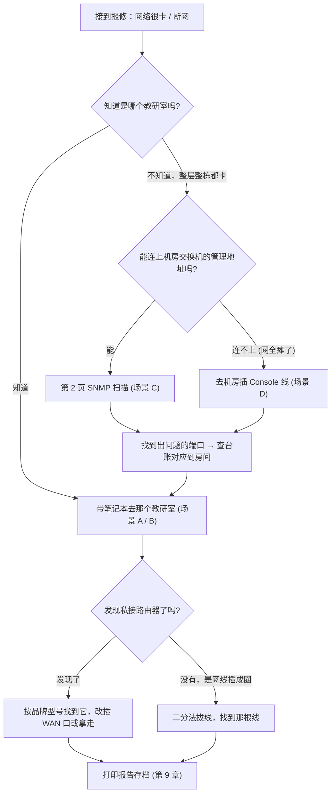

# LoopFinder 校园网环路定位仪 · 新手使用手册（v2.3）

> 写给谁看：负责学校网络的老师/运维同事，**不需要很懂网络**。
> 本手册按「**遇到什么情况 → 带什么 → 一步一步怎么点 → 看到什么说明什么**」来写，遇到问题直接翻到对应场景即可。

---

## 目录

- [第 0 章 · 先看这里：这个工具能帮你做什么](#第-0-章--先看这里这个工具能帮你做什么)
- [第 1 章 · 遇到问题先查这张表（场景导航）](#第-1-章--遇到问题先查这张表场景导航)
- [第 2 章 · 5 个必须知道的名词（小词典）](#第-2-章--5-个必须知道的名词小词典)
- [第 3 章 · 准备工作：要带什么、要问谁要什么](#第-3-章--准备工作要带什么要问谁要什么)
- [第 4 章 · 安装和打开软件](#第-4-章--安装和打开软件)
- [第 5 章 · 第一次使用：花 10 分钟用演练模式熟悉一遍](#第-5-章--第一次使用花-10-分钟用演练模式熟悉一遍)
- [第 6 章 · 场景详解（核心章节）](#第-6-章--场景详解核心章节)
  - [场景 A：某个教研室突然全体断网 / 网速特别卡](#场景-a某个教研室突然全体断网--网速特别卡)
  - [场景 B：有些电脑能连网但上不了网，IP 变成了 192.168.x.x](#场景-b有些电脑能连网但上不了网ip-变成了-192168xx)
  - [场景 C：一整层 / 一整栋楼都卡，不知道是哪个房间](#场景-c一整层--一整栋楼都卡不知道是哪个房间)
  - [场景 D：能进机房，但网络瘫了连不上交换机](#场景-d能进机房但网络瘫了连不上交换机)
  - [场景 E：在交换机上敲了命令，输出看不懂](#场景-e在交换机上敲了命令输出看不懂)
  - [场景 F：想让交换机一出问题就自动提醒我](#场景-f想让交换机一出问题就自动提醒我)
  - [场景 G：局域网正常，但访问某个网段/服务器不通](#场景-g局域网正常但访问某个网段服务器不通)
- [第 7 章 · 平时没出事时，提前做好这 3 件事](#第-7-章--平时没出事时提前做好这-3-件事)
- [第 8 章 · 界面上的颜色、分数怎么看](#第-8-章--界面上的颜色分数怎么看)
- [第 9 章 · 处理完之后：报告和防止再犯](#第-9-章--处理完之后报告和防止再犯)
- [第 10 章 · 常见问题（打不开、连不上、没反应）](#第-10-章--常见问题打不开连不上没反应)
- [第 11 章 · 安全须知（务必读一遍）](#第-11-章--安全须知务必读一遍)

---

## 第 0 章 · 先看这里：这个工具能帮你做什么

学校教研室里最常见的"网络瘫痪"，绝大多数是下面两种情况造成的：

1. **网线插成了一个圈（环路）**
   比如老师把一根网线的两头都插进了桌子底下的同一个小交换机；或者把家用无线路由器的两个 LAN 口都插到了墙上的网口。
   结果就是：数据包在这个圈里无限转圈、越转越多（叫"广播风暴"），把整个教研室、甚至整层楼的网络都堵死。

2. **私接的家用路由器插反了**
   老师自己带了个 TP-LINK / 小米 / 水星路由器，把墙上的网线插到了路由器的 **LAN 口**（应该插 WAN 口）。
   结果就是：周围电脑会从这个小路由器那里拿到 `192.168.1.x` 之类的错误地址，显示"已连接"却上不了网。

**LoopFinder 帮你做的事：**

| 你想知道 | 工具怎么帮你 |
|---|---|
| 到底是不是环路？ | 笔记本插上网线，几秒钟内告诉你"确认环路"还是"网络正常" |
| 是哪个私接路由器？ | 直接列出它的地址、品牌，甚至型号（如 `TL-WR886N`），让老师认领 |
| 桌子底下十几根线，是哪一根？ | "二分法拔线向导"：每次拔一半，拔对了电脑会"叮咚"一声，3~4 次就找到 |
| 整栋楼卡，是哪个房间？ | 连上机房交换机，自动找出风暴是从哪个端口进来的，再对应到房间和墙面网口编号 |

**它不能做的事（先说清楚，免得白跑一趟）：**

- ❌ 它**不会**自动帮你拔线或关端口，最后一步需要你动手。
- ❌ 只插在一台**傻瓜交换机**（没有管理功能的小交换机）上时，它**无法直接告诉你是第几号口**，需要配合"二分法拔线"来找。
- ❌ 它**不会**修改交换机的任何配置，所有交换机操作都是"只看不改"。

---

## 第 1 章 · 遇到问题先查这张表（场景导航）

| 你看到的现象 | 你在哪里 | 翻到 | 用软件的哪一页 |
|---|---|---|---|
| 某个教研室全体断网、网速特别慢 | 能进这间教研室 | [场景 A](#场景-a某个教研室突然全体断网--网速特别卡) | 第 1 页「教研室现场定位」 |
| 有的电脑显示已连接但上不了网，IP 是 `192.168.x.x` | 能进这间教研室 | [场景 B](#场景-b有些电脑能连网但上不了网ip-变成了-192168xx) | 第 1 页「教研室现场定位」 |
| 一整层/一整栋楼都卡，不知道哪个房间 | 在办公室/机房，能连上交换机管理地址 | [场景 C](#场景-c一整层--一整栋楼都卡不知道是哪个房间) | 第 2 页「弱电间汇聚/接入(SNMP)」 |
| 网络全瘫了，远程连不上交换机 | 能进机房/弱电间，带了 Console 线 | [场景 D](#场景-d能进机房但网络瘫了连不上交换机) | 第 3 页「Console直连」 |
| 交换机上敲了命令，满屏英文看不懂 | 任何地方 | [场景 E](#场景-e在交换机上敲了命令输出看不懂) | 第 3 页「日志一键解析」 |
| 想让交换机一出事就主动提醒我 | 有固定的办公电脑 | [场景 F](#场景-f想让交换机一出问题就自动提醒我) | 第 3 页「Syslog 雷达」 |
| 局域网能用，但访问某个服务器/网段不通 | 任何地方 | [场景 G](#场景-g局域网正常但访问某个网段服务器不通) | 第 3 页「三层路由环路检测」 |

**最常见的完整排查路线：**



---

## 第 2 章 · 5 个必须知道的名词（小词典）

| 名词 | 大白话解释 |
|---|---|
| **环路 / 广播风暴** | 网线插成了一个圈，数据在圈里无限复制转圈，把网络堵死。现象：所有电脑都卡、交换机的灯疯狂闪。 |
| **傻瓜交换机 / 网管交换机** | **傻瓜交换机**：教研室桌子底下那种 5 口、8 口、16 口的小盒子，插电就能用，没有设置界面。**网管交换机**：机房机柜里的设备，背面或正面有一个标着 `CONSOLE` 的口，品牌常见华为、H3C（新华三）、锐捷、思科。 |
| **汇聚交换机 / 接入交换机** | 学校网络像一棵树：**核心交换机**（树根，在网络中心）→ **汇聚交换机**（树干，通常一栋楼一台）→ **接入交换机**（树枝，通常每层的弱电间一台）→ 教研室墙上的网口（树叶）。 |
| **弱电间 / 墙面面板** | **弱电间**：每层楼放交换机的小房间/小柜子。**墙面面板**：教研室墙上的网线插口，每个口一般有编号贴纸。 |
| **MAC 地址** | 每个网络设备的"身份证号"，长这样：`D8:0D:17:6A:3B:9C`。前半段能看出是哪个品牌（工具会自动帮你翻译成"TP-LINK"等）。 |

另外 3 个你会在界面上看到的词：

- **Console 线**：一头是 USB、一头是水晶头（RJ45）的蓝色或黑色线，插在交换机的 `CONSOLE` 口上，**不走网络**，网全瘫了也能用。网上搜"USB 转 Console 线"几十块钱一根。
- **SNMP 团体名**：可以理解为交换机的"只读查询密码"，通常是 `public` 或学校自定义的一串字符。要找网络管理员或当初装交换机的厂商要。
- **LLDP**：交换机之间互相"打招呼"的功能。开着它，工具就能自动知道"这个口下面连的是哪台交换机"。

---

## 第 3 章 · 准备工作：要带什么、要问谁要什么

### 3.1 硬件清单

| 东西 | 必须吗 | 用在哪 | 备注 |
|---|---|---|---|
| 笔记本电脑（Mac 或 Windows） | ✅ 必须 | 所有场景 | |
| **USB 转有线网口**（如果笔记本没有网线口） | ✅ 去教研室必须 | 场景 A、B | 现在很多笔记本没网口，买一个 USB-C 转千兆网口的转接头。**不要用 Wi-Fi 测环路**，测不准。 |
| 一根普通网线（1~2 米） | ✅ 去教研室必须 | 场景 A、B | 用来把笔记本插到教研室的小交换机或墙口上 |
| **USB 转 Console 线** | 进机房才需要 | 场景 D | 插交换机 `CONSOLE` 口用 |
| 标签纸 + 笔 | 建议 | 所有场景 | 找到问题网线后马上贴标签，避免下次再找 |

### 3.2 信息清单（建议提前找网络管理员/厂商要好，记在本子上）

| 信息 | 用在哪 | 去哪要 |
|---|---|---|
| 各栋楼汇聚、接入交换机的**管理 IP 地址** | 场景 C | 网络管理员 / 网络拓扑图 / 当初的施工文档 |
| 交换机的 **SNMP 只读团体名** | 场景 C | 同上（常见默认是 `public`，但很多学校改过） |
| 交换机 **Console 登录密码**（如果设置了） | 场景 D | 同上 |
| 学校正常的 **DHCP 服务器地址**（给电脑分配 IP 的那台） | 场景 A、B | 网络管理员；或者在一台正常电脑上看它的"DHCP 服务器"地址 |
| 交换机端口 ↔ 教研室墙面网口的**对应表** | 场景 C、D | 布线施工文档；没有的话按[第 7 章](#第-7-章--平时没出事时提前做好这-3-件事)逐步整理 |

> [!TIP]
> 上面这些信息**不是全都必须有**。只有笔记本 + 网线，也能完成最常用的场景 A 和场景 B。

---

## 第 4 章 · 安装和打开软件

> [!TIP]
> **开袋即食，不用装 Python！** 从 v2.3 开始，直接下载打包好的安装包（Mac 的 `.dmg` 或 Windows 的 `.zip`），双击就能打开。

### 4.1 下载安装包（推荐）

打开下载页：https://github.com/AtomBoyC/campus-loopfinder/releases/latest

滚到页面下方的 **Assets**，按你的电脑选对应文件：

| 你的电脑 | 下载这个文件 | 怎么看自己是哪一种 |
|---|---|---|
| **Windows 10 / 11** | `LoopFinder-Windows-x64.zip` | 普通 Windows 笔记本都选这个 |
| **Mac（苹果自研芯片）** | `LoopFinder-macOS-AppleSilicon.dmg` | 点屏幕左上角 🍎 → **关于本机**，看到「芯片：Apple M1 / M2 / M3 / M4」选这个 |
| **Mac（老款 Intel 芯片）** | `LoopFinder-macOS-Intel.dmg` | 点屏幕左上角 🍎 → **关于本机**，看到「处理器：Intel Core」选这个 |

### 4.2 Mac 电脑

**安装（只需做一次）：**

1. 双击下载好的 `.dmg` 文件，弹出一个窗口。
2. 把左边的 **`LoopFinder.app`** 拖到右边的 **`Applications`（应用程序）** 文件夹里。
3. 以后直接从「启动台」或「应用程序」里双击 **`LoopFinder`** 打开即可。

> [!WARNING]
> **第一次双击如果系统提示"无法验证开发者 / 已损坏，无法打开"怎么办？**
> 因为这是开源免费工具，没有花钱买苹果付费签名证书。只需要解除一次下载隔离标记：
> 1. 打开「终端」（在启动台或聚焦搜索里搜"终端"）。
> 2. 复制粘贴下面这一行，按回车：
>    ```bash
>    xattr -cr /Applications/LoopFinder.app
>    ```
> 3. 再双击 **`LoopFinder`** 就能正常打开了（只需要做这一次）。

**开启教研室有线抓包权限（免敲命令）：**

- 如果你只是**演练**，或者只做**机房 SNMP / Console 排查（场景 C、D、E）**：打开软件直接就能用，**不用输入任何密码**。
- 如果你要**去教研室插网线实时测环路（场景 A、B）**：打开软件后，点页面顶部黄色条里的 **`🔐 一键开启本机抓包权限`**，在系统弹出的密码框里输入你的 Mac 开机密码点「好」，立刻就能抓包（直到下次重启电脑前都有效）。

### 4.3 Windows 电脑

**打开软件：**

1. 右键下载好的 `LoopFinder-Windows-x64.zip` → **全部解压缩**（建议解压到一个固定文件夹，如 `D:\LoopFinder`，不要直接在压缩包里双击运行）。
2. 双击 **`LoopFinder.exe`**。
3. 系统弹出"你要允许此应用对你的设备进行更改吗？"→ 点 **「是」**。
4. 如果 Windows 防火墙弹窗询问是否允许访问网络 → 点 **「允许访问」**。
5. 等 3~5 秒软件主窗口就会弹出（第一次解压运行稍慢几秒，正常现象）。

> [!IMPORTANT]
> **关于 Npcap 抓包驱动（只需装一次）：**
> - **机房查交换机（SNMP）、插 Console 线、演练模式**：不用装任何驱动，双击 `LoopFinder.exe` 就能直接用！
> - **去教研室插网线实时测环路 / 扫私接路由器（场景 A、B）**：需要装一次免费的网卡抓包驱动 **Npcap**（如果电脑装过 Wireshark，通常已经装好了）。
>   1. 软件顶部黄色条里直接点 **`📥 下载 Npcap 抓包驱动`**（或打开 https://npcap.com/#download）。
>   2. 下载并安装，安装界面记得勾选 **`Install Npcap in WinPcap API-compatible Mode`**，一路下一步装完。
>   3. 关掉再重新双击打开 `LoopFinder.exe`，顶部黄色条消失就说明就绪了。

### 4.4 认识界面

软件顶部有 4 个页签，记住它们各管什么：

| 页签 | 什么时候用 |
|---|---|
| **1. 教研室现场定位** | 人在教研室，笔记本插着网线时用 |
| **2. 弱电间汇聚/接入(SNMP)** | 通过网络远程查看机房交换机时用 |
| **3. Console直连 & Syslog/日志** | 人在机房插着 Console 线时用；或者解析交换机日志时用 |
| **4. 台账 · 报告** | 录入"交换机端口 ↔ 房间"对应表；打印排查报告 |

右上角还有几个常用按钮：

- **🔊 声音雷达**：打勾后，发现环路会"嘀嘀"报警，环路消失会"叮咚"一声。**钻桌底拔线时非常有用，建议一直开着**，并把电脑音量调大。
- **☀️ 亮色 / 🌙 暗色**：切换界面颜色。教研室光线亮时用亮色看得更清楚。
- **🖨️ 打印报告**：生成本次排查的报告（会在系统浏览器中打开，方便打印或另存为 PDF）。

### 4.5 从源码运行（可选，给习惯自己跑代码的同事）

如果你不想下打包版，而是从 GitHub 点 `Code → Download ZIP` 下载了源码：
- **Mac**：解压后双击 `启动_macOS.command`（或终端执行 `python3 app.py`）。
- **Windows**：先装 Python 3.9+（勾选 `Add Python to PATH`），再右键 `启动_Windows.bat` → **以管理员身份运行**（首次会自动创建虚拟环境并安装依赖）。

---

## 第 5 章 · 第一次使用：花 10 分钟用演练模式熟悉一遍

**强烈建议第一次使用前先演练一遍。** 演练模式用的是模拟数据，不会碰你学校的任何网络设备，可以随便点。

### 演练 1：教研室环路（3 分钟）

1. 打开软件，在第 1 页「本机网卡」下拉框里选择 **`✨ [仿真演练模式] 模拟 302 大教研室路由器环路 + 私接 TP-LINK`**。
2. 点 **`▶ 开始监测`**。
3. 观察：顶部大横幅变红，显示 **"🚨 确认环路"**；下方"私接小路由器清单"里出现一台红色标记的 TP-LINK。
4. 点紫色条上的 **`🔌 模拟拔掉故障支线`**，1~2 秒后横幅变绿，显示 **"✅ 环路已断开"**，并响起"叮咚"提示音。
   👉 这就是现场拔对网线时你会看到和听到的效果。
5. 点 **`■ 停止`** 结束。

### 演练 2：机房交换机逐级追踪（3 分钟）

1. 切到第 2 页「弱电间汇聚/接入(SNMP)」。
2. 点 **`✨ 演练 3 级跨品牌追踪`**。
3. 观察"自动逐跳追踪路径结果"：工具从核心交换机出发，自动走到汇聚交换机，再走到楼层接入交换机，最后停在 **"302大教研室 · 东墙4号信息点"**。
4. 往下看"交换机面板状态矩阵"：红色方块就是出问题的端口，点一下可以看详情。

### 演练 3：Console 直连（2 分钟）

1. 切到第 3 页，在 Console 卡片右上角点 **`✨ 模拟 Console 直连汇聚`**。
2. 等几秒，看结果表格：排第一、标着 **"🚨 广播源头灌入口"** 的就是风暴进来的端口；右边还写着这个端口下面连的是哪台交换机。

演练完这三个，你就掌握 90% 的用法了。

---

## 第 6 章 · 场景详解（核心章节）

### 场景 A：某个教研室突然全体断网 / 网速特别卡

**你可能看到：** 老师们都说网络不能用了；教研室桌子底下的小交换机所有灯都在疯狂快闪。

**要带：** 笔记本（Mac 打开后点顶部「🔐 一键开启本机抓包权限」；Windows 需装过一次 Npcap）、USB 网口转接头、一根网线。

#### 第一步：找到这间教研室的"总交换机"

一般在教研室角落或某张桌子底下，墙上的网线插进去，再分出很多根网线到各个桌子。如果有好几台小交换机串在一起，**先找离墙口最近的那台**。

#### 第二步：插上笔记本，开始监测

1. 把笔记本用网线插到这台小交换机的**任意一个空口**上。
   > 如果没有空口，临时拔掉一台不重要的电脑的网线，用那个口。
2. 打开软件第 1 页，「本机网卡」选择带 **`🔌有线`** 标记的那一项。
   > 网卡显示"已插线/无IP"是正常的，网络瘫痪时拿不到地址，**不影响检测**。
3. 「探测策略」保持 **`主动二层探针 + 被动听诊（推荐）`**；「告警灵敏度场景」保持 **`标准（大教研室推荐）`**。
4. 点 **`▶ 开始监测`**，等 5~10 秒。

#### 第三步：看结果，判断是哪种情况

| 顶部横幅显示 | 说明 | 下一步 |
|---|---|---|
| **🚨 确认环路**（红色闪烁） | 这里确实有环路 | 先看第四步，再做第五步 |
| **⚠️ 疑似异常**（黄色） | 可能有私接路由器，或者广播偏多 | 看"私接小路由器清单"，转到[场景 B](#场景-b有些电脑能连网但上不了网ip-变成了-192168xx) |
| **🟢 网络正常**（绿色） | 你插的这台交换机下面没有环路 | 问题可能在别的小交换机或者上一级，换一台小交换机再测；或者转到[场景 C](#场景-c一整层--一整栋楼都卡不知道是哪个房间) |

#### 第四步：先看有没有"现成的嫌疑人"

往下翻，看两个表格：

- **🚨 私接小路由器 / DHCP 服务器清单**：如果有一行标着红色 **"私接非法"**，并且写着品牌和型号（比如 `TP-LINK (TL-WR886N)`），**直接在教研室里找这个品牌型号的路由器**，大概率就是它。检查它的网线是不是插在了 LAN 口上（应该插 WAN 口，WAN 口通常颜色不同或单独靠边），或者是不是两个口都插到了交换机上。
- **🔁 高频重复帧**：这里列出的 MAC 地址后面如果标着红色"家用路由器/小交换机"，也是重点嫌疑。

找到并处理后，看横幅是否变成 **"✅ 环路已断开"**。变了就解决了。

#### 第五步：没有现成嫌疑人？用"二分法拔线"

如果是纯粹的网线插成了圈，就用二分法。**原理很简单：每次拔掉一半的网线，看风暴停没停，范围就缩小一半。** 16 根线最多拔 4 次就能找到。

**开始前先做 3 件事：**

1. ✅ 跟教研室老师打个招呼："要拔几分钟网线排查故障"。
2. ✅ 确认右上角 **🔊 声音雷达** 已打勾，电脑音量开大。
3. ✅ **数一下这台小交换机上插了几根网线，减去你笔记本自己那根**。比如一共插了 9 根，减去笔记本那根，就是 8 根。
   > ⚠️ **笔记本那根线始终不要拔，也不要算进去！** 拔了就测不到了。

**给网线编号：** 从左到右，把除笔记本之外的网线依次叫做 1 号、2 号、3 号……（可以用标签纸临时贴一下）。

**开始操作：**

1. 在右边「✂️ 教研室「二分法拔线」现场向导」里，"当前交换机已插网线数"填刚才数的数字（例：`8`），点 **`开始二分法`**。
2. 向导会用三种颜色清楚标出每根线的状态：
   - **🔴 红色 = 这一步拔掉**
   - **🔵 蓝色 = 这一步保持插着**（之前拔掉的要插回去）
   - **🟢 绿色 = 已经排除嫌疑，全部插回去**（让这些老师先恢复上网）
3. 按照颜色调整网线，然后**等 5 秒**，看屏幕或听声音：
   - 听到"叮咚"、横幅变绿 → 点 **`✅ 拔掉后变绿/风暴消失了`**
   - 还在"嘀嘀"报警、横幅还是红色 → 点 **`🚨 拔掉后仍然红灯/风暴还在`**
4. 向导会自动更新下一步的红、蓝、绿编号，照着继续调整网线。
5. 重复第 3~4 步，直到向导显示 **"🎯 锁定故障支路！问题网线位于第 X 号网口"**。

**举个例子（8 根线，问题出在 3 号）：**

| 步骤 | 向导说 | 你的操作 | 结果 | 你点 |
|---|---|---|---|---|
| 第 1 步 | 拔 1~4（红），留 5~8（蓝） | 拔掉 1、2、3、4 | 叮咚，变绿 | ✅ 变绿了 |
| 第 2 步 | 拔 1~2（红），留 3~4（蓝） | 插回 3、4；1、2 保持拔掉；5~8 本来就插着 | 嘀嘀，又红了 | 🚨 仍然红灯 |
| 第 3 步 | 拔 3（红），留 4（蓝） | 插回 1、2（已排除）；拔掉 3；4 插着 | 叮咚，变绿 | ✅ 变绿了 |
| 结果 | 🎯 第 3 号网口 | 顺着 3 号线找到对应的桌子 | | |

> [!TIP]
> 点错了没关系，点 **`↩ 撤销`** 可以回到上一步。

#### 第六步：顺着网线找到源头

顺着找到的那根网线一路摸过去，通常会发现：

- 网线两头插在了**同一台**小交换机上（插成了圈）→ 拔掉一头；
- 网线连着一台家用路由器，路由器又有另一根线插回了交换机 → 只保留一根，并插到路由器的 WAN 口；
- 网线连着**另一台小交换机** → 把笔记本插到那台小交换机上，**从第二步重新来一遍**，继续往下找。

最后点右上角 **🖨️ 打印报告** 存档（见[第 9 章](#第-9-章--处理完之后报告和防止再犯)）。

---

### 场景 B：有些电脑能连网但上不了网，IP 变成了 192.168.x.x

**你可能看到：** 电脑右下角显示"已连接"，但打不开网页；在电脑上查 IP 地址，发现是 `192.168.0.x`、`192.168.1.x`、`192.168.31.x` 这种，和学校正常的地址不一样。

**原因：** 教研室里有人私接了家用路由器，并且把线插反了，这台路由器在给周围电脑"乱发地址"。

**要带：** 笔记本（Mac 打开后点顶部「🔐 一键开启本机抓包权限」；Windows 需装过一次 Npcap）、USB 网口转接头、一根网线。

#### 操作步骤

1. **先告诉软件学校正常的 DHCP 服务器是哪个**（只需设置一次）：
   在第 1 页"🚨 私接小路由器 / DHCP 服务器清单"右上角的输入框里，填学校正常 DHCP 服务器的 IP（多个用英文逗号隔开），点 **`存白名单`**。
   > 不知道填什么？问网络管理员；或者在一台**能正常上网**的电脑上查看网络详情里的"DHCP 服务器"一栏。
2. 笔记本插到这间教研室的小交换机或墙口上，选有线网卡，点 **`▶ 开始监测`**。
3. 点 **`📡 扫私接路由`**。这会让教研室里所有能分配地址的设备"报上名来"。
4. 等几秒，看清单：
   - 标 **绿色"合法白名单"** 的：学校正常的服务器，不用管。
   - 标 **红色"私接非法"** 的：就是它！表格里会显示：
     - **网关 IP**：比如 `192.168.1.1`
     - **厂商**：比如 `TP-LINK (普联)`
     - **识别型号(Web)**：比如 `TP-LINK (TL-WR886N)`（工具会自动尝试读取路由器管理页面的标题）

#### 找到这台路由器

- **方法一（最快）**：在教研室里喊一声"谁用了 TP-LINK 886N 路由器？"，或者挨个桌子找这个型号。
- **方法二（没人认）**：点表格里那个**蓝色的 MAC 地址**，软件会跳到第 2 页，在机房交换机上反查它接在哪个墙面网口（前提是你已经能用[场景 C](#场景-c一整层--一整栋楼都卡不知道是哪个房间) 连上那台交换机，并扫描过一次）。

#### 处理方法

找到路由器后，把墙上来的网线**改插到路由器的 WAN 口**（通常颜色不同，或者单独在一边，标着 WAN / Internet），或者直接请老师把路由器拿走。处理完，有问题的电脑**拔一下网线再插上**（或者重启），就能重新拿到正确地址。

> [!NOTE]
> 如果顶部出现红色横幅 **"🚨 检测到 ARP IP / 网关地址冲突"**，意思是有两台设备在抢同一个地址（常见是私接路由器抢了学校网关的地址）。处理方法同上，找到横幅里列出的那台非学校设备即可。

---

### 场景 C：一整层 / 一整栋楼都卡，不知道是哪个房间

**适用条件：** 你的电脑能连上机房交换机的管理地址（比如在网络中心办公室，或者能 ping 通交换机 IP），并且知道 SNMP 团体名。

> 如果网络已经瘫到连不上交换机了，直接去看[场景 D](#场景-d能进机房但网络瘫了连不上交换机)。

**这一页的原理（一句话）：** 环路产生的风暴，会从**出问题的那个端口**大量"灌进"交换机。软件会读取交换机每个端口"进来了多少广播"，谁进来的最多，问题就在谁那边。

这一页提供 3 种用法，**从简单到省事**：

#### 用法 1：只查一台交换机（最简单，先从这个开始）

1. 在第 2 页左上角 **「🔍 单台交换机双采样深度扫描」** 中填写：
   - **交换机管理 IP**：比如这栋楼汇聚交换机的 IP
   - **SNMP 团体名**：比如 `public`
   - **版本**：先选 `SNMPv2c (推荐)`；如果扫不出来，再试 `SNMPv1 (老旧设备)`
2. 点 **`🔍 开始双采样扫描`**，等 3~5 秒（软件会读两次数据算差值）。
3. 看结果：
   - **交换机面板状态矩阵**：每个方块是一个端口。**红色方块**就是风暴来源的方向。
   - **🔥 高危异常端口排行榜**：排第一的就是最可疑的端口，后面会写原因，比如"广播风暴 7420 pps"。
   - **⚡ 实时 MAC 地址漂移告警**：如果这里有记录，基本可以 100% 确定有环路，表里会写出是哪两个端口之间在"打架"。
4. 看排第一的端口：
   - 如果后面写着 **"↘ 追踪下级 XXX"** 的蓝色按钮，说明这个端口下面还接着另一台交换机（比如某层的接入交换机），**点这个按钮**，软件会自动去扫那台交换机。重复这一步，直到没有"追踪下级"按钮为止。
   - 如果没有按钮，这个端口就是直接通向某个教研室的。如果你录了台账（[第 7 章](#第-7-章--平时没出事时提前做好这-3-件事)），端口下面会直接显示 **"第一教学楼 · 302大教研室 · 东墙4号信息点"**。然后带笔记本去那个房间，做[场景 A](#场景-a某个教研室突然全体断网--网速特别卡)。

#### 用法 2：一键自动逐级追踪（省事，推荐熟悉后使用）

跟用法 1 一样，只是**不用你一级一级点**。

1. 在右上角 **「🚀 一键自动逐跳顺藤摸瓜」** 填写起点交换机 IP（汇聚或核心交换机）。
2. "追踪目标 MAC"**先留空**（留空 = 自动追查风暴最大的方向）。
3. 点 **`🚀 自动逐跳定位末端端口`**。
4. 软件会画出一条路径，比如：
   `第1跳 核心交换机 → 第2跳 3楼汇聚交换机 GE1/0/14 → 第3跳 3楼东接入交换机 GE0/0/14 (📍302大教研室·东墙4号信息点)`
   最后一个红框就是要去的地方。

> [!IMPORTANT]
> 自动追踪需要交换机之间开启了 **LLDP** 功能（大多数网管交换机默认开着）。如果追到某一级就停了，提示"已定位到最末端"，但你知道下面还有交换机，说明那台没开 LLDP，用用法 1 手动输入下一台的 IP 继续查。
> 如果各台交换机的 SNMP 团体名不一样，先在下方"资产簿"里把每台的团体名存好，自动追踪时会自动用对应的团体名。

**追某个具体的设备：** 如果你在场景 B 里抓到了私接路由器的 MAC 地址，可以把它填到"追踪目标 MAC"里，软件会一路追到这个设备插在哪个墙面网口。

#### 用法 3：一键扫全楼（适合平时巡检）

1. 先在 **「🏢 弱电间交换机资产簿」** 里把这栋楼的交换机都录进去：点开「展开/管理已保存交换机资产清单」，填 IP、设备名、楼栋、角色、团体名，点 **`+ 保存设备`**。（想看示例格式，可点旁边的 **`载入示例设备`** 参考。）
2. 下拉框选择楼栋，点 **`⚡ 并发扫所选交换机`**。
3. 几秒后得到一张**风险排行表**：风险分最高、广播最大、有 MAC 漂移的交换机排在最上面。点任意一行，就能看那台交换机的详细端口情况。

#### 临时止血（需要有权限，谨慎操作）

如果整栋楼都瘫了、需要先恢复大家上网，可以先让有权限的管理员**临时关闭**找到的那个端口（或者在弱电间直接拔掉对应的跳线），整栋楼通常会马上恢复。然后再去那个教研室彻底处理。**处理完记得把端口重新打开。**

---

### 场景 D：能进机房，但网络瘫了连不上交换机

**为什么用 Console：** 环路严重时，交换机忙得连远程管理都响应不了（SNMP 扫描会超时）。Console 线是直接插在交换机上的"专用通道"，**不走网络，网全瘫了也能连**。

**要带：** 笔记本、USB 转 Console 线。用打包版（`.app` / `.exe`）打开直接就能用，Mac 不需要输密码、Windows 不需要装 Npcap。

#### 第一步：插线

1. 在交换机上找标着 **`CONSOLE`** 的口（有的在前面板，有的在背面，形状和网口一样）。
2. Console 线的水晶头插到 `CONSOLE` 口，USB 头插到笔记本上。

> [!WARNING]
> 不要插错到普通网口上！Console 口通常单独在一边，旁边印着 `CONSOLE` 或 `CON`。

#### 第二步：在软件里连接

1. 打开第 3 页，找到 **「🔌 Console 串口直连自动定位广播源头口」** 卡片。
2. 点 **"Console 串口设备"** 旁边的 **`↻`** 刷新，下拉框里选带 🔌 的那一项：
   - Mac 上通常叫 `/dev/cu.usbserial-xxxx` 或 `/dev/cu.wchusbserial-xxxx`
   - Windows 上通常叫 `COM3`、`COM4` 之类
   > 列表里没有？看[第 10 章「找不到串口」](#q找不到-console-串口下拉框里只有仿真演练)。
3. 其他选项保持默认：**波特率 `9600`**、**交换机品牌 `自动识别 (推荐)`**。
4. 如果平时用 Console 登录这台交换机需要输入用户名密码，把它们填到"可选: Console 用户名 / 登录密码"里；思科和锐捷如果有 enable 密码也填上。不需要密码的留空。
5. "可选: 该交换机管理 IP"：填上的话，结果里会自动显示端口对应的房间（需要录过台账）。
6. 点 **`⚡ 一键双采样找广播源头口`**，等 10~30 秒（华为交换机会稍慢一些）。

> [!IMPORTANT]
> 如果你同时开着 SecureCRT、PuTTY、MobaXterm 等终端软件连着同一根 Console 线，**先把它们关掉**，否则软件会提示串口被占用。

#### 第三步：看结果

结果表格按嫌疑程度从高到低排列，重点看"方向判定"这一列：

| 方向判定 | 意思 | 怎么办 |
|---|---|---|
| **🚨 广播源头灌入口 (In主导)** | 风暴就是从这个口进来的 | 这就是要找的端口 |
| **⚡ MAC漂移涉事口** | 交换机日志记录这个口有地址在乱跳 | 和上面那个一起重点排查 |
| **⚪ 受害转发口 (Out主导，可排除)** | 它只是被风暴"连累"，往外发了很多 | **可以排除**，不用管 |
| **🟢 正常端口** | 正常 | 不用管 |

然后看排第一的那行的 **"LLDP 下联设备"** 一列：

- 写着某台交换机的名字（比如 `↘ HW-3F-East-SW02`）→ 问题在那台交换机下面。拿着 Console 线去那台交换机所在的弱电间，**重复本场景的全部步骤**。
- 写着"直连末端/无LLDP" → 这个口直接通向某个教研室（或者接的是傻瓜交换机）。查台账或者顺着线找到房间，去做[场景 A](#场景-a某个教研室突然全体断网--网速特别卡)。

> [!TIP]
> 结果下面有个 **"查看本次 Console 完整原始交互回显"**，点开能看到软件实际在交换机上敲了什么命令、交换机回了什么。如果结果表格是空的，把这里面的内容发给懂网络的同事（或项目作者）分析。

---

### 场景 E：在交换机上敲了命令，输出看不懂

**适用：** 你（或同事）已经用 SecureCRT、PuTTY 等终端软件登录了交换机，敲了查看命令，但满屏英文和端口号看不懂。

**常用的查看命令（按品牌）：**

| 品牌 | 查 MAC 漂移（环路最直接的证据） | 查环路检测结果 |
|---|---|---|
| 华为 | `display mac-address flapping record` | `display loopback-detect` |
| 新华三 H3C | `display mac-address mac-move` | `display loopback-detection` |
| 锐捷 | `show logging` | `show rldp` |
| 思科 | `show logging` | `show interfaces status err-disabled` |

> 这些命令都只是"查看"，不会改动交换机设置。

**操作步骤：**

1. 在终端软件里把命令的输出**全选复制**。
2. 打开软件第 3 页，最下方 **「📋 交换机日志一键解析」**。
3. 把内容粘贴到大文本框里；上面的小框里填这台交换机的 IP（可选，填了能显示房间号）。
4. 点 **`🔍 一键解析`**。
5. 看结论：
   - **受害端口**表：哪些端口卷入了环路（会显示对应的房间）；
   - **可疑 MAC** 表：哪些设备在两个端口之间来回跳，品牌是什么（标红"家用路由器"的重点关注）。

> 想先看看效果？点 **`载入示例华为日志`** 再点解析。

---

### 场景 F：想让交换机一出问题就自动提醒我

**适用：** 你有一台**固定放在办公室、IP 地址不变**的电脑，希望交换机检测到环路时主动"喊"你，不用等老师来报修。

> [!NOTE]
> 这个功能需要网络管理员在交换机上做一次设置（让交换机把告警发到你的电脑）。笔记本的 IP 经常变，不太适合用这个功能。

**操作步骤：**

1. 打开第 3 页 **「📡 实时 Syslog 交换机环路告警雷达」**，端口保持 `1514`，点 **`▶ 启动雷达`**。
   - 如果系统弹窗询问"是否允许接受传入的网络连接"，点 **允许**。
2. 请网络管理员在各台交换机上配置：把日志（Syslog）发送到**你这台电脑的 IP**，端口 **1514**。（不同品牌命令不同，管理员会知道怎么配；华为/H3C 一般是 `info-center loghost <你的电脑IP> port 1514`。）
3. 配好后，可以点 **`✨ 模拟注入告警`** 测试一下效果。
4. 以后交换机一旦检测到环路、MAC 漂移或广播风暴，软件会：
   - 弹出红色提示，并发出提示音（需开着声音雷达）；
   - 第 3 页标签上出现红色数字；
   - 告警表里直接显示是哪台交换机、哪个端口、对应哪个房间。

> 软件需要一直开着才能收到告警。

---

### 场景 G：局域网正常，但访问某个网段/服务器不通

**这种情况比较少见**，通常是机房里的核心/汇聚设备路由配置有问题（叫"三层路由环路"），一般需要网络管理员处理。你可以先用工具确认一下，把结果交给管理员。

1. 打开第 3 页 **「🧭 三层路由环路检测」**，输入访问不通的那个服务器 IP，点 **`▶ 探测三层路径`**。
2. 等十几秒，看结果：
   - 显示 **"✅ 路由路径正常"** → 不是路由环路问题。
   - 显示 **"🚨 检测到三层路由环路"**，表格里有标红的 **"🔁 重复回环跳！"** → 数据在两台设备之间来回打转。把这个结果截图（或打印报告）发给网络管理员，告诉他这两台设备的 IP。

---

## 第 7 章 · 平时没出事时，提前做好这 3 件事

**提前花一点时间准备，出事时能省下大量时间。**

### 7.1 录入"交换机端口 ↔ 房间"对应表（台账）——最有价值

有了台账，软件查到问题端口时会直接告诉你"第一教学楼 · 302大教研室 · 东墙4号信息点"，而不是一个看不懂的 `GE0/0/14`。

> 首次打开时台账是干净空白的，可以直接录入自己学校的；如果不清楚怎么填，可以点右上角 **`✨ 载入示例模板`** 参考一下，之后再删掉。

**方法一：一条一条录（适合少量）**

在第 4 页表格上方填写：交换机 IP、端口名、楼栋、教研室/房间、墙面面板号、备注，点 **`+ 新增/更新`**。

**方法二：用 Excel 批量导入（推荐）**

1. 新建一个 Excel 表格，**第一行**写这些列名（中英文都可以）：

   | 交换机IP | 端口 | 楼栋 | 教研室 | 面板编号 | 备注 |
   |---|---|---|---|---|---|
   | 10.10.2.12 | GE0/0/14 | 第一教学楼 | 302大教研室 | 东墙4号 | 数学组 |
   | 10.10.2.12 | GE0/0/15 | 第一教学楼 | 302大教研室 | 东墙5号 | 英语组 |

2. 另存为：**"CSV UTF-8（逗号分隔）"** 格式（一定要选带 UTF-8 的，否则中文会乱码）。
3. 在软件第 4 页点 **`📥 导入 CSV`**，选择这个文件。

> [!TIP]
> - 端口名不用纠结写法：`GE0/0/14`、`GigabitEthernet0/0/14`、`Gi0/0/14` 软件都认作同一个口。
> - 不知道对应关系？下次去弱电间时，可以在某个教研室墙口插上笔记本，打开第 1 页开始监测，等 30 秒左右，"上联交换机自动识别"那一栏会显示这个墙口接在哪台交换机的哪个端口上，顺手记下来就行。（需要交换机开启了 LLDP 或 CDP 功能，大多数网管交换机默认是开着的；如果一直显示"监听中"，说明没开，只能对照布线图或问施工方。）

### 7.2 录入交换机资产簿

在第 2 页 **「🏢 弱电间交换机资产簿」** 点开「展开/管理已保存交换机资产清单」，把各栋楼的交换机录进去（IP、名称、楼栋、SNMP 团体名）。以后就能一键扫全楼、自动追踪时自动用对的团体名。

### 7.3 用演练模式教会同事

把[第 5 章](#第-5-章--第一次使用花-10-分钟用演练模式熟悉一遍)的 3 个演练让每个可能去现场的同事都做一遍，10 分钟就够。

> 台账和资产簿保存在电脑的用户目录里（Mac：`~/.loopfinder/`，Windows：`%APPDATA%\LoopFinder\`），不在软件文件夹里，**更新软件不会丢失**。想备份或拷给同事：第 4 页点 `📤 导出 CSV`，第 2 页点 `导出资产CSV`。

---

## 第 8 章 · 界面上的颜色、分数怎么看

### 第 1 页顶部大横幅

| 显示 | 意思 |
|---|---|
| 待机中 | 还没开始监测 |
| 🟢 网络正常 | 没检测到环路 |
| ⚠️ 疑似异常 | 发现了私接路由器、地址冲突，或者广播偏多但还不算风暴 |
| 🚨 确认环路 | 环路置信度 ≥ 60%，基本确定有环路 |
| ✅ 环路已断开 | 风暴突然大幅下降——**刚刚拔掉的那根线很可能就是元凶** |

右边的 **"环路置信度"** 是 0~100 的分数，越高越确定。下面一行小字会写出判断依据，比如"重复广播帧爆发""严重广播风暴"。

### 第 1 页的 4 个数字卡片

| 卡片 | 正常大概是多少 | 有环路时 |
|---|---|---|
| 广播速率 | 几到几十 pps | 几百到几千 pps |
| 重复帧爆发 | 0 或个位数 | 几十到几百 pps——**这是环路最典型的特征** |
| 主动探针回环 | 0 次 | 有数字——软件自己发出去的探测包绕了一圈又回来了，**环路铁证** |
| 私接小路由器 | 0 台 | ≥ 1 台 |

> pps = 每秒多少个数据包。

### 第 2 页交换机面板矩阵的方块颜色

| 颜色 | 意思 |
|---|---|
| 🔴 红框 | 高危：广播风暴或 MAC 漂移，**重点查** |
| 🟠 橙框 | 预警：广播偏高，或者这一个端口下面连了很多设备（说明下面串了小交换机） |
| 🟢 绿框 | 正常在用 |
| ⬜ 灰色 | 没插线 |

**环路风险分**：0~100 分，≥ 65 分是红色，25~64 分是橙色。

### "告警灵敏度场景"怎么选

| 选项 | 适合 | 什么时候换 |
|---|---|---|
| 高灵敏（小型办公室） | 10 人以下的小办公室 | 小房间里明明很卡，但"标准"模式不报警时 |
| **标准（大教研室推荐）** | 大多数教研室 | 默认用这个 |
| 抗干扰（机房/大VLAN） | 机房、电脑特别多的大房间 | 网络明明正常，却总是报"疑似异常"时 |

---

## 第 9 章 · 处理完之后：报告和防止再犯

### 9.1 打印排查报告

点右上角 **🖨️ 打印报告**（或第 4 页的 **`🖨️ 打开排查报告`**），会打开一个报告页面，里面汇总了这次排查的所有发现：现场检测结果、私接路由器、交换机端口情况、时间线等。

- 点报告右上角的 **"🖨️ 打印 / 另存为 PDF"** 即可打印，或者在打印窗口里选"存储为 PDF"保存。
- 可以作为工单附件，或发到工作群里说明情况。

> 如果需要更专业的分析，第 1 页的 **`💾 PCAP`** 按钮可以导出原始抓包文件，用 Wireshark 软件打开，或者发给设备厂商的技术支持。

### 9.2 防止同一个教研室再出问题

1. **跟老师说清楚**：家用路由器墙上的网线要插 **WAN 口**；不要把一根网线两头插在同一个交换机上；不确定的时候找信息中心。
2. **给找到的网线贴标签**，写上"已排查，勿插某某口"。
3. **请网络管理员在楼层交换机上开启防环功能**（这是治本的办法）：
   - **环路检测**：交换机发现某个口有环路时，自动把这个口关掉，不会拖垮整层楼。
   - **广播风暴抑制**：限制每个口的广播量。
   - **DHCP Snooping**：只允许学校正规的服务器分配地址，私接路由器插反了也不会影响别人。

   > ⚠️ 这些配置要由懂设备的人，按交换机型号的官方手册来做，并先在一台不重要的交换机上测试。配置错了可能导致整层楼的电脑拿不到地址。

---

## 第 10 章 · 常见问题（打不开、连不上、没反应）

### Q：双击没反应 / 提示"无法验证开发者 / 已损坏" / Windows 蓝屏保护提示
- **Mac**：打开「终端」，复制粘贴执行一次 `xattr -cr /Applications/LoopFinder.app` 回车，然后再双击 `LoopFinder` 即可（见[第 4.2 节](#42-mac-电脑)）。
- **Windows**：如果 Windows Defender SmartScreen 弹出蓝色框「Windows 已保护你的电脑」，点 **`更多信息`** → **`仍要运行`**（开源工具未购买商业签名证书，属正常现象）。如果报缺少文件，确认你已经把 ZIP **全部解压缩**，不要在压缩包里面直接双击。

### Q：软件窗口没弹出来
打开电脑上的 Chrome / Edge / Safari 浏览器，访问 `http://127.0.0.1:18765` 看看是否已经启动。如果使用打包版仍打不开，可在用户目录（Mac：`~/.loopfinder/loopfinder.log`，Windows：`%APPDATA%\LoopFinder\loopfinder.log`）查看错误日志。

### Q：第 1 页顶部一直显示黄色提示"尚未开启本机有线抓包权限 / 需安装 Npcap"
- **Mac**：直接点黄色条里的 **`🔐 一键开启本机抓包权限`**，在弹窗里输入你的 Mac 开机密码即可立刻解锁，**不用重启软件**。
- **Windows**：点黄色条里的 **`📥 下载 Npcap 抓包驱动`** 下载安装（勾选 `WinPcap API-compatible Mode`），装完关闭并重新打开 `LoopFinder.exe`。如果只做机房 SNMP / Console / 演练，可以忽略这条提示直接使用。

### Q：网卡下拉框里找不到我的有线网卡
确认 USB 网口转接头已插好、网线两头都插好；点下拉框右边的 **`↻`** 刷新。Mac 上有线网卡通常叫 `en5`、`en6`、`en7` 等（不是 `en0`，`en0` 一般是 Wi-Fi）。

### Q：开始监测后一直显示"网络正常"，但教研室确实很卡
1. 确认你插的是**这间教研室**的交换机，而不是别的房间的。
2. 卡顿不一定是环路，可能是外网出口带宽不够、某台电脑中毒在大量下载等。
3. 如果这间教研室有好几台小交换机串着，环路可能在另一台下面，换一台插上再测。
4. 试试把"告警灵敏度场景"改成 **高灵敏**。

### Q：SNMP 扫描提示"超时或无响应"
按顺序检查：
1. 你的电脑能不能连上这台交换机？（打开终端/命令行输入 `ping 交换机IP` 看看有没有回复。）
2. 团体名对不对？**区分大小写**。
3. 交换机可能设置了"只允许某些 IP 查询"，请管理员把你电脑的 IP 加进去。
4. 老旧交换机试试把版本改成 **SNMPv1**。
5. 如果网络正在瘫痪中，交换机可能忙不过来，改用 Console（[场景 D](#场景-d能进机房但网络瘫了连不上交换机)）。

### Q：找不到 Console 串口（下拉框里只有"仿真演练"）
1. 拔掉 Console 线重新插一下，点 **`↻`** 刷新。
2. 换一个 USB 口试试。
3. 可能需要装驱动：看 Console 线的包装或商品页，常见芯片是 **CH340**、**PL2303**、**FTDI**，去对应官网下载驱动安装，装完重启电脑。
4. 如果是从源码运行（不是下载的 `LoopFinder.exe` 打包版），Windows 需确认运行 `启动_Windows.bat` 完成了依赖安装（`pyserial`）。打包版 `LoopFinder.exe` 已内置串口库。

### Q：Console 点了开始，结果是空的 / 提示失败
1. **关掉 SecureCRT、PuTTY、MobaXterm 等其他终端软件**，它们会占用串口。
2. 确认线插的是交换机的 `CONSOLE` 口，不是普通网口。
3. 波特率换成 `115200` 再试（个别新型号设备默认不是 9600）。
4. 如果交换机要求登录，确认填了正确的用户名和密码。
5. 展开结果下面的 **"查看本次 Console 完整原始交互回显"**：
   - 如果里面完全是空的或乱码 → 线、驱动或波特率的问题；
   - 如果能看到交换机的输出，但表格是空的 → 可能是你这个型号的输出格式软件还不认识，把回显内容复制下来，发到项目的 GitHub Issues 里。

### Q：二分法拔完了，但一直找不到
- 确认每一步都**等了 5 秒**再判断。
- 确认笔记本那根线没有被拔、也没有被算进网线数量里。
- 如果几次结果自相矛盾，可能有**不止一处**环路，或者环路在上一级交换机。点 **`重置`** 重新开始，或者换一台交换机测。

### Q：我录的台账去哪了？换电脑怎么办？
台账保存在用户目录里（Mac：`~/.loopfinder/`，Windows：`%APPDATA%\LoopFinder\`）。换电脑前，在第 4 页点 **`📤 导出 CSV`**，到新电脑上用 **`📥 导入 CSV`** 导入即可。

---

## 第 11 章 · 安全须知（务必读一遍）

1. **拔线前先跟老师打招呼**，说明大概要断网几分钟。
2. **机房交换机上不要随便关端口、改配置**。需要临时关端口止血时，由有权限的管理员操作，并记得事后恢复。
3. **软件本身对交换机"只看不改"**：
   - SNMP 只读取数据；
   - Console 只执行"查看"类命令（以及一个只对当前连接有效的"不分页显示"设置），不会进入配置模式、不会关端口、不会保存任何配置。
4. **"主动探针"不会加重风暴**：每 1.5 秒才发一个很小的探测包；检测到风暴已经很严重（超过 400 pps）时，会自动停止发包。如果你所在的网络对任何额外数据都很敏感，可以把探测策略改为 **"纯被动只读听诊（绝对零发包）"**。
5. **软件只在你自己的电脑上运行**（地址 `127.0.0.1`），别人访问不到；浏览器里打开的其他网站也无法偷偷操作它。
6. **台账、团体名等学校内部信息只保存在你的电脑上**，不会上传到任何地方，也不会随软件代码一起分享出去。
